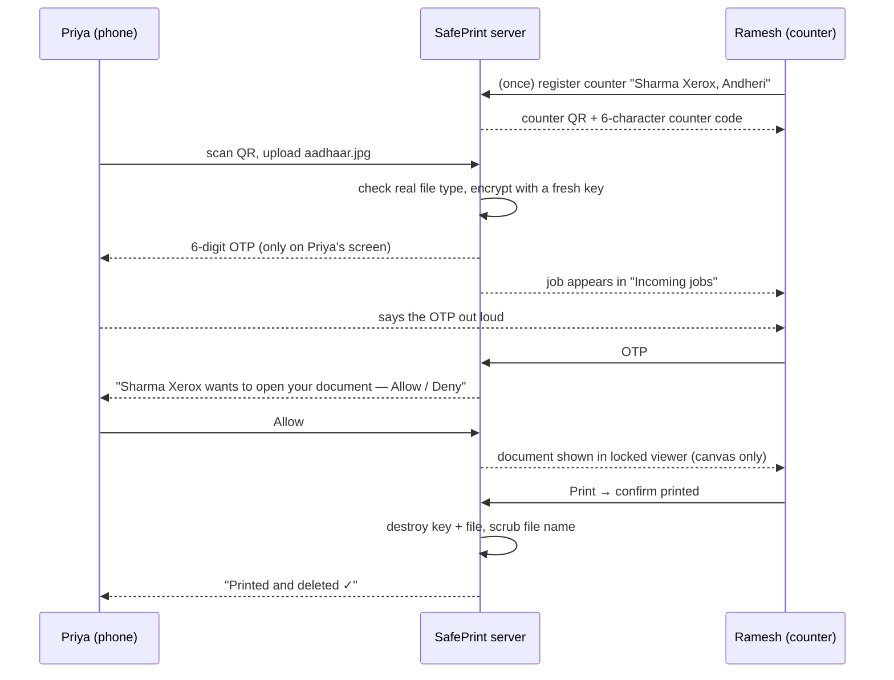
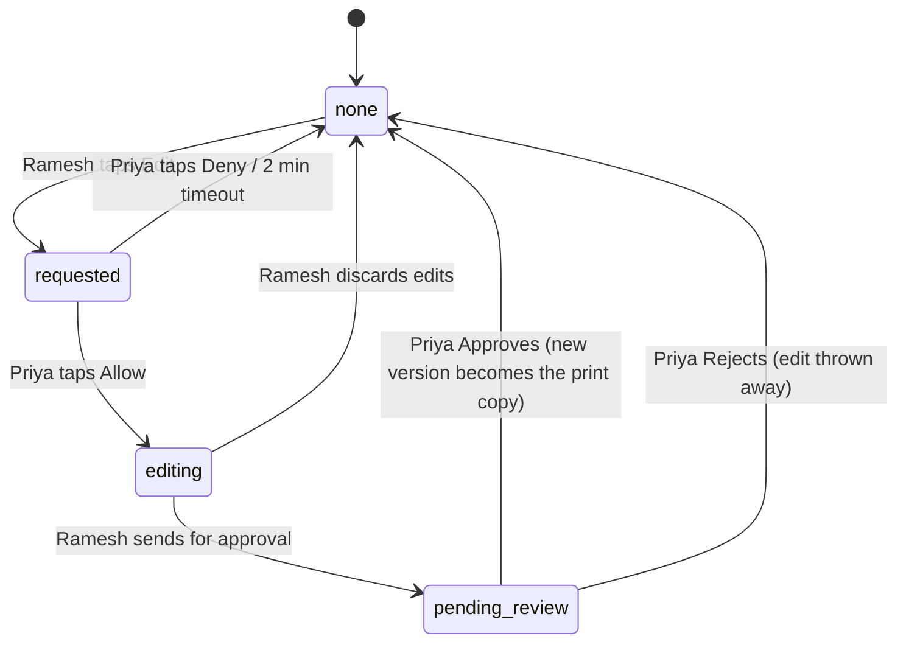

# How SafePrint works — explained with an example

This document walks through everything SafePrint does by following one customer, step by
step. Each step says what the people see and what happens behind the screen.

> **The example**
>
> **Priya** needs two things printed at **Sharma Xerox** in Andheri:
> 1. a copy of her **Aadhaar card** (a phone photo, `aadhaar.jpg`)
> 2. her **rent agreement** (a Word file, `rent-agreement.docx`). Its paragraphs are
>    badly aligned, and she wants the shop to fix them before printing.
>
> **Ramesh** runs the counter at Sharma Xerox.

---

## 1. What SafePrint is, in one paragraph

Today, people send Aadhaar, PAN cards, marksheets and bank statements to photocopy shops
over WhatsApp or email. The shop ends up with a permanent copy on its phone or computer,
which can be misused for SIM fraud, loan fraud or identity theft. **SafePrint lets the
shop print the document without ever getting a copy of it.** The file never lands on the
shop's computer, is only viewable after the customer approves, can be printed at most
twice, and is destroyed as soon as it is printed (or after 30 minutes at most).

## 2. Who is involved

| Who / what | What they use | Their role |
|---|---|---|
| **Customer** (Priya) | Any phone browser — no app to install | Uploads the file, holds the OTP, approves every step |
| **Shop operator** (Ramesh) | `/shop` in a browser, **or** the SafePrint Agent desktop app | Opens, adjusts, edits (with permission) and prints |
| **SafePrint server** | Next.js app + MongoDB | Stores files **encrypted**, checks OTPs, enforces every rule, keeps an audit log |
| **Word editor** | Self-hosted ONLYOFFICE Document Server | Converts Word files to PDF, and hosts the locked Word editor |

## 3. The journey, step by step

### Step 1 — The shop sets up its counter (one time only)

Ramesh opens `https://print.<your-domain>/shop` (or the desktop agent) and enters his shop
name and area: *"Sharma Xerox, Andheri"*. He gets:
- a **counter QR code** to stick on the counter
- a 6-character **counter code**, as a fallback for people who can't scan

**Behind the screen:**
- There is no password. Ramesh's browser keeps a random **device key**, and the server
  stores only its SHA-256 hash. Whoever holds that key *is* this counter.
- Registration is rate-limited (5 per hour per IP).

### Step 2 — Priya uploads her Aadhaar photo

Priya scans the QR. Her phone opens SafePrint with *"Printing at Sharma Xerox, Andheri"*
at the top. She picks `aadhaar.jpg` and taps **Lock & get OTP**.

**Behind the screen:**
1. **The real file type is checked from its contents, not its name.**
   - Accepted: PDF, JPG, PNG, and Word (`.docx`/`.doc`).
   - Macro-enabled Word files, other zip files, and anything else are refused.
   - Maximum size is 15 MB. Oversized uploads are cut off while still arriving, so they
     can't fill the server's memory.
2. **Encryption with a key for this file only.** The file is encrypted with AES-256-GCM
   using a brand-new random key. That key is itself encrypted ("wrapped") with the
   server's master key and stored only in the session record. The storage disk only ever
   holds unreadable ciphertext.
3. **A session is created** with:
   - a **share code**
   - a **6-digit OTP**, valid for 10 minutes. The server stores only a keyed hash of it,
     never the OTP itself.
   - a **30-minute life**
4. Because Priya came from Sharma Xerox's QR code, the session is **paired** to that
   counter. Only Ramesh's counter can open it.

Priya's phone now shows the OTP, with Show/Hide and **Regenerate** buttons, a live status
line and a 30-minute countdown. The OTP is never sent by SMS and never written to any log.

### Step 3 — Ramesh enters the OTP, and Priya allows it

The job appears in Ramesh's **Incoming jobs** list. Priya reads out her OTP and Ramesh
types it in.

**Behind the screen:**
- **Wrong OTPs.** After **5 wrong tries** the file is destroyed. Priya's phone shows a live
  "⚠ 2 wrong attempts" style warning, so she knows if someone is guessing.
- **Approval prompt.** A correct OTP is not enough on its own. Priya's phone now asks:
  **"Sharma Xerox wants to open your document — Allow / Deny"**.
  - If she does nothing for **2 minutes**, it is automatically denied.
  - Until she taps **Allow**, the server refuses to send a single byte of the document.

### Step 4 — The document opens in a locked viewer

Ramesh sees the Aadhaar photo on screen.

**Behind the screen:**
- **Drawn as pixels only.** The document is painted onto a `<canvas>`. There is no file
  link, image element or download URL anywhere on the page that "Save as" could grab.
- **Shortcuts and mouse actions are blocked:** right-click, Ctrl+S, Ctrl+P, copy, drag and
  text selection.
- **Watermark.** In the browser, every pixel carries a faint watermark
  (`SAFEPRINT · SP-<code>`) and a footer with the share code, date and time. Any copy that
  escapes (a photo of the screen, "Save as PDF") is visibly marked and traceable back to
  this exact session.
- **Header-only access.** The server only answers with the access token in the request
  header (never in a URL), and only after Priya has allowed it. Each session allows at
  most 20 page fetches.

### Step 5 — Layout adjustments (no permission needed)

The photo is slightly tilted on the page. Ramesh can:
- **Turn** pages, and **nudge** them by the millimetre
- **Shrink or fit** to the paper; choose **A4, Letter or Legal**
- Print in **black & white**, or **skip** pages

**Behind the screen:**
- **No enlarging past the paper.** Pages can't be enlarged past the paper.
- **Off-paper warning.** If a layout pushes content off the sheet, a warning shows and the
  audit log records `offPaper`.
- **Mixed orientations.** In a mixed portrait/landscape document, the job prints in one
  sheet orientation. Pages running the other way are **turned 90°**, not shrunk.

Layout changes only how the page sits on the paper, so they are recorded with the print
and don't need Priya's permission. *Changing what the page says* is an **Edit** (section 4).

### Step 6 — Print

Ramesh clicks **Print**. Each session allows **2 print attempts**, in case of a paper jam.
- **In the browser**, the normal print dialog opens and only the canvases are printed.
- **In the desktop agent**, the job goes straight to a physical printer with no dialog at
  all (section 5).

### Step 7 — The file is destroyed

When Ramesh confirms the print, the file is gone:
- **Crypto-shredding.** The encrypted file is deleted, and its key is blanked in the
  database. Even a stray copy of the encrypted file can never be decrypted again.
- **File name scrubbed.** It becomes `[deleted]` straight away.
- **Priya's phone** updates live: *Printed and deleted*.
- **Retention.** The scrubbed session record is deleted after **30 days**, and the audit
  log entries after **90 days**.

The same destruction also happens if Ramesh closes the window, or when the **30-minute**
session time runs out. A cleanup job checks every 60 seconds.

---

## 4. Fixing a document at the counter — the rent agreement

Priya now uploads `rent-agreement.docx` the same way. Ramesh opens it (OTP, then Allow)
and sees the paragraphs are misaligned. Just as in a real shop, he can fix it — but only
with Priya's permission, and only if she approves the result.

**What happens to the Word file at upload.** The server sends it to the ONLYOFFICE server,
which converts it to PDF for viewing and printing. The original Word file is kept
**encrypted** as well, so it can be edited later. If many Word files arrive at once, a
queue limits conversions (2 at a time, up to 10 waiting). Beyond that, the upload gets a
"busy, try again" message.

### The edit flow

1. **Permission.** Ramesh taps **Edit**. Priya's phone asks *"Sharma Xerox wants to EDIT
   your document — Allow / Deny"*. If she doesn't answer within 2 minutes, it is denied.
   - When she allows editing, the session gets a one-time **15-minute extension**.
2. **Ramesh edits**, in one of two ways:
   - **As Word** (for Word uploads). The real document opens in the embedded ONLYOFFICE
     editor, where he can change fonts, alignment, spacing and text.
     - **Download, Print and Copy are switched off** by permissions the server signs. The
       shop's browser cannot change them.
     - In our example, Ramesh selects all, left-aligns, removes the stray indents and fixes
       a typo.
   - **With photo tools** (for any PDF, photo or scan), for example the tilted Aadhaar photo:
     - **Crop, rotate, straighten**, and **perspective-fix** a phone photo taken at an angle
     - **Brightness, contrast, black & white**, and **scan cleanup** (whitens the paper,
       removes shadows)
     - **Whiteout, eraser, pen, text, boxes, lines and arrows**, with undo/redo
     - The editing screen carries the same watermark as the viewer.
3. **Send to customer for approval.** The edited version goes **to the server, encrypted**,
   never to Ramesh's disk. Printing is blocked while an edit is open or waiting for review.
4. **Priya reviews on her phone.** She sees exactly what will print:
   - **Approve**: the edited version becomes the print copy, and the old version is
     destroyed.
   - **Reject**: the edit is thrown away, and the original stays.
5. **Limit.** A document allows at most **3 edit rounds**.

**Cleanup for the Word editor.** When a Word edit round or the session ends, SafePrint
tells the editor server to disconnect the editor and delete its working copies. The editor
server's own cache is cut from 24 hours to 30 minutes.

## 5. The SafePrint Agent (desktop app for shops)

A web page cannot control the computer's print dialog, so in the browser Ramesh *could*
pick "Save as PDF" (the copy would carry the watermark). The **SafePrint Agent** — a
Windows/macOS/Linux app — closes that gap:

| Feature | What it does |
|---|---|
| **Silent printing** | Sends the job straight to the printer. The print dialog never opens, so "Save as PDF" never appears |
| **Physical printers only** | Hides virtual printers (Microsoft Print to PDF, XPS, OneNote, CUPS-PDF, PDF24…), and checks the printer again at print time |
| **Screen-capture blocking** | The window shows black in screenshots and screen sharing on Windows and macOS (Linux has no way to do this) |
| **Counter mode** | Shows the counter QR and incoming jobs; the operator only types the OTP |
| **Token isolation** | Access tokens never reach the part of the app that draws the screen |
| **HTTPS only** | Refuses to talk to a server without HTTPS (except on the same machine, for testing) |
| **Audit** | Prints are logged as `agent/<version>`, so agent prints are distinguishable from browser prints |

Agent prints have **no watermark**, because the agent removes the leak path entirely.

## 6. Security in plain words (with the real numbers)

| Protection | How it works | Default |
|---|---|---|
| Encryption | AES-256-GCM, a fresh key per file, wrapped by the master key | — |
| Deletion | The key is blanked and the file deleted, so even old copies are unreadable | after print, close, or 30 min |
| OTP | 6 digits, stored only as a keyed hash, compared in constant time | 10 min life; 5 tries; 5 regenerations |
| Customer approval | Required to view, and again to edit, and again to accept the edit | 2 min to answer |
| Prints | Per session | 2 attempts |
| Upload limits | Per IP (sized for mobile networks sharing an IP) and per phone | 60/hour per IP, 10/hour per phone, 20 Word files/hour per IP |
| OTP-check limits | Per IP | 60/minute |
| Guessing-attack brakes | Per share code (any IP), per counter, and service-wide | 5/min per code, 30 misses/min per counter, 300 misses/min service-wide |
| Same answer, same speed | Every failed check gets the identical "Wrong code or OTP" message, padded to ≥250 ms, so an attacker can't tell which codes exist | 250 ms |
| Real client IP | Taken only from what our own proxy (Caddy) adds; a faked `X-Forwarded-For` header is ignored | `TRUST_PROXY_HOPS=1` |
| Browser hardening | Strict Content-Security-Policy with a per-request nonce, no framing, HSTS, no referrer | always on in production |
| Audit log | Every upload, OTP attempt, approval, view, edit and print, with time + IP — never the file name | kept 90 days |

All of these limits can be changed with settings (see the table in `README.md`).

## 7. What happens when things go wrong

| Situation | What SafePrint does |
|---|---|
| Priya never taps Allow | Auto-denied after 2 minutes; Ramesh sees "denied", and nothing was shown |
| Priya leaves without printing | The file self-destructs after 30 minutes |
| Ramesh types the wrong OTP 5 times | The file is destroyed; Priya sees the warnings live and can upload again |
| The OTP expired (10 min) | Priya taps **Regenerate** (up to 5 times) |
| Paper jam | A second print attempt is allowed; after that the session is used up |
| Ramesh closes the browser tab | Best-effort close destroys the file; otherwise the 30-minute timer does |
| Priya rejects an edit | The edit is thrown away and the original remains printable |
| Too many Word files at once | Up to 2 convert at once, 10 wait; beyond that the upload gets "busy, try again" |
| Someone at another shop guesses codes | Same error, same speed, braked per code, per counter and service-wide |
| The server restarts | Sessions and files survive (they're in MongoDB and on disk, encrypted); in-memory rate-limit counters reset |

## 8. Where it runs

The recommended free setup is **one Oracle Cloud Always Free server in India**, running:
- the app
- MongoDB
- the ONLYOFFICE Word editor
- Caddy, for automatic HTTPS
- nightly encrypted database backups

See [`deploy/oracle/README.md`](../deploy/oracle/README.md).

## 9. Glossary

| Term | Meaning |
|---|---|
| **Share code** | Short code identifying one upload session. Used with the OTP when there's no counter pairing |
| **OTP** | 6-digit one-time code, shown only on the customer's phone and said aloud at the counter |
| **Counter / counter code** | A registered shop counter, and the 6-character code in its QR |
| **Paired session** | A session uploaded via a counter's QR; only that counter can open it |
| **Allow / Deny** | The customer's on-phone approval, required to view and to edit |
| **Crypto-shredding** | Deleting a file by destroying its encryption key, so every copy becomes unreadable |
| **Watermark** | Faint session-coded marking on everything the browser shows and prints |
| **Edit round** | One cycle of: edit permission → edit → customer review (max 3) |
| **Document Server** | The self-hosted ONLYOFFICE server that converts and edits Word files |
| **Agent** | The SafePrint desktop app for shops: dialog-free physical printing |
